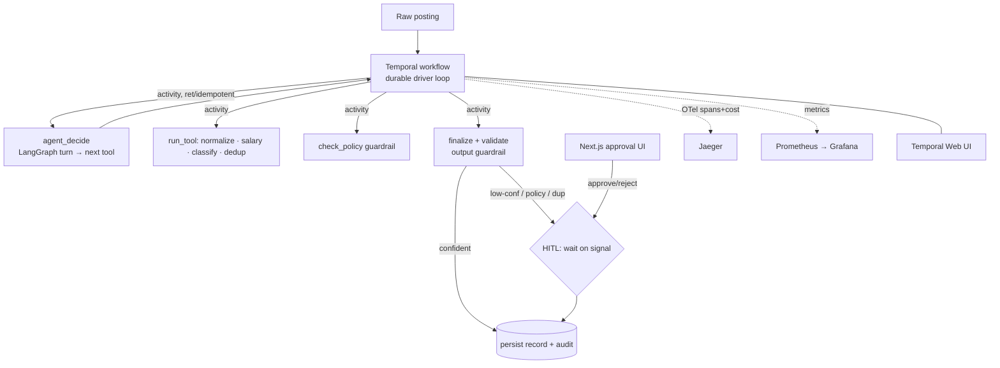

# Conductor

**A durable, observable, tool-calling AI agent.** It ingests a raw, messy job posting;
plans and calls typed tools to normalize, classify, dedupe, and policy-check it; pauses for
**human approval** on low-confidence or policy-blocked cases; and — the point — **survives a
worker crash mid-run and resumes exactly where it left off**. Quality is held by a
**trajectory + task-success eval harness that gates CI**, and every run is traced end-to-end.

> Most "AI agents" are single-turn wrappers that silently fail. A production agent is a
> distributed system: durable state, retries, idempotency, compensation, approval gates,
> guardrails, tracing, evaluation. Conductor is built that way, and proves it by getting
> `SIGKILL`ed mid-run and recovering with identical output.

The winning production pattern is **Temporal for the durable outer workflow + LangGraph for
the inner agentic steps** — that's exactly how this is wired.

---

## The one idea that matters

**The Temporal workflow drives the agent loop, and every LLM call and every tool call is its
own activity.** That is the only wiring where "kill the worker mid-run → resume from the last
completed step, re-paying no LLM cost and duplicating no writes" is actually true.



Why not the alternatives?

| Option | Durability granularity | Verdict |
|---|---|---|
| Whole agent inside one activity | crash re-runs the entire agent, re-spends every LLM call | ❌ durable in name only |
| LangGraph graph run inside the workflow | forbidden — non-deterministic code in the replay sandbox | ❌ illegal |
| **Workflow drives loop; each step an activity** | per-step; finished steps replay from history, never re-execute | ✅ **chosen** |

LangGraph expresses the agent's per-turn decision graph (propose → validate → repair) and
structured output; **Temporal owns durability + HITL** (a signal wait, not LangGraph's
checkpointer — deliberately, so there's one source of truth for durable state).

---

## Failure modes (and how the design survives each)

| Failure | Without design | Conductor |
|---|---|---|
| Worker crashes mid-run | work lost / restarts from zero | Temporal replays history; resumes at last completed activity; no re-spend |
| LLM times out / flakes | run hangs or 500s | activity `start_to_close` timeout + `RetryPolicy` with backoff |
| Retry re-runs a write | double audit rows / double record | idempotency key + `UNIQUE` constraint + upsert; re-run is a no-op |
| LLM emits invalid JSON | half-written record | enforced structured output; bounded retries → `FAILED_VALIDATION`, nothing persisted |
| Ambiguous posting | silent wrong answer | confidence gate → HITL signal wait |
| Policy violation | bad record shipped | `check_policy` BLOCK forces human review regardless of confidence |
| Reviewer never responds | stuck forever | SLA timeout → `REVIEW_TIMED_OUT` |
| Telemetry backend down | crash on export | OTel wrapped; safe no-op |
| Duplicate re-submission | corpus pollution | pgvector dedup flags near-dupes → review |

## The reliability proof (CI-asserted)

`make chaos` (and the CI `chaos` job): start a workflow, let the agent run every enrichment
step and park in the durable review gate, **`SIGKILL` the worker**, start a *fresh* worker,
and assert it (1) reconstructs the full trajectory + proposed record purely from Temporal
event history, (2) resumes to `COMPLETED` with **identical output**, and (3) leaves **no
duplicate side effects** (exactly one audit row per step, enforced by a DB `UNIQUE`
constraint). See [`tests/test_chaos.py`](python/tests/test_chaos.py).

## Published metrics

Full table in [docs/METRICS.md](docs/METRICS.md). Under the deterministic CI provider:
`task_success` **1.00** (floor 0.90), `tool_selection_f1` **1.00** (0.90), `output_validity`
**1.00** (0.99). **~61%** of gold postings auto-resolve with no human touch; the rest route
correctly. **0** lost/duplicated runs across injected worker crashes.

---

## Run it (one command)

```bash
cp .env.example .env
docker compose up -d --build          # base stack (no secrets needed — default provider is a deterministic fake)
# or, with tracing + dashboards:
make obs-up
```
Then open the **approval UI** at http://localhost:3000 and follow [docs/DEMO.md](docs/DEMO.md).
Run with a real model via `LLM_PROVIDER=ollama` (host Ollama) or `LLM_PROVIDER=anthropic`.

```bash
make test     # unit + time-skipping workflow tests (hermetic)
make eval     # the CI eval gate
make chaos    # the crash-and-resume proof (needs temporal + app-db up)
```

## Design decisions worth defending

- **Why durable execution at all** — an agent that calls paid tools and waits on humans is a
  long-running distributed process; crashing and silently losing/​repeating work is the
  default failure, and Temporal's event-sourced replay is the fix.
- **Structured-output routing, not native function-calling** — small local models
  (`llama3.2:3b`) are unreliable at tool-calling; constraining the decision to a small JSON
  schema is far more dependable, and a `FakeLLM` makes CI fully hermetic.
- **pgvector, not a second datastore** — Postgres already holds records + audit; one store
  does dedup too (HNSW cosine index).
- **Confidence is a formula over tool signals, not an LLM self-report** — a model-invented
  "confidence" isn't calibrated; `location resolved? salary parsed? category sure? duplicate?`
  is auditable and testable.

## Stack

Python 3.12 · **Temporal** 1.30 (`temporalio`) · **LangGraph** 1.x (`StateGraph`) · Pydantic v2 ·
PostgreSQL 16 + **pgvector** · FastAPI · Next.js 15 (App Router) + Tailwind · OpenTelemetry →
**Jaeger** 2 + **Prometheus**/**Grafana** · Docker Compose · GitHub Actions. Pluggable LLM
(fake · Ollama · Anthropic) and embedder (fake hashing · bge-small). See
[docs/DESIGN.md](docs/DESIGN.md), [docs/REQUIREMENTS.md](docs/REQUIREMENTS.md),
[docs/PLAN.md](docs/PLAN.md).

## What I'd do next

Multi-agent supervisor/worker split · promote run status to a Temporal Search Attribute (so
`/pending` scales past a full-scan) · auto-mine failed eval cases into new gold cases ·
per-tenant policy packs · deploy to a cloud Temporal namespace.

## Repo layout

```
python/conductor/  settings · models · llm/ · embed/ · tools/ · agent/ · temporal/ · db/ · api/ · eval/ · obs/
python/tests/      unit · time-skipping workflow · chaos · eval
ui/                Next.js approval UI
infra/             otel · prometheus · grafana
docs/              REQUIREMENTS · DESIGN · PLAN · DEMO · METRICS
docker-compose.yml · Makefile · .github/workflows/ci.yml
```
